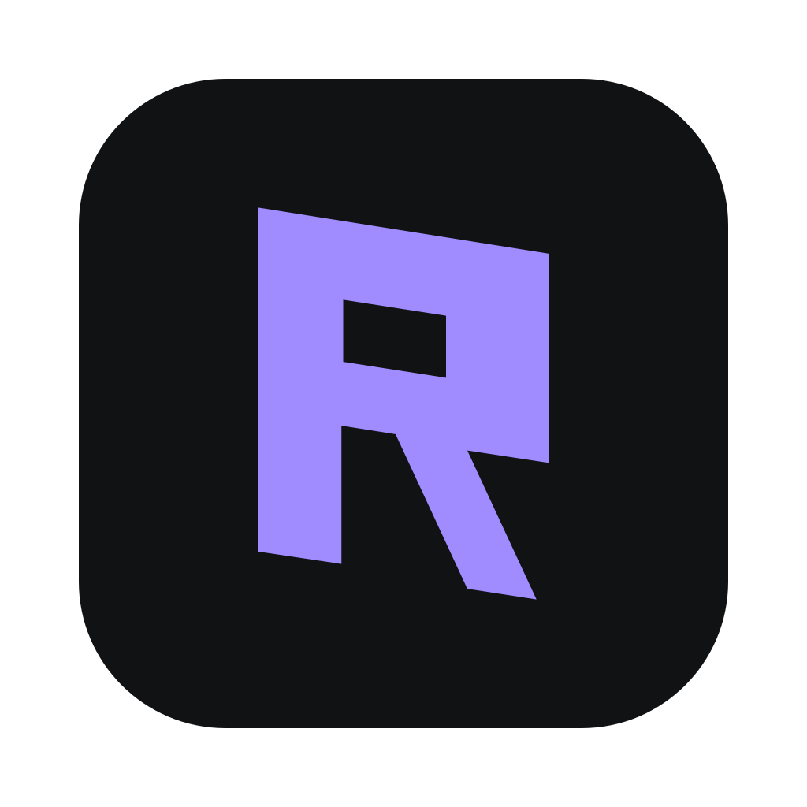

<p align="center">
  
</p>

<h1 align="center">Rits</h1>

<p align="center">
  <b>A IDE leve para engenharia de dados.</b><br>
  Código Python e Go, SQL em nove bancos (e compatíveis), diagramas ER, Docker, Terraform e Kubernetes, numa janela só.
</p>

<p align="center">
  <b>Português</b> · <a href="README.en.md">English</a>
</p>

---

## O que é o Rits

Um dia de trabalho de engenharia de dados costuma passar por várias ferramentas: o PyCharm para o pipeline em Python, o DataGrip ou o DBeaver para consultar o banco, o Docker Desktop para subir o Postgres local, um terminal para o `terraform plan` e mais um para o `kubectl`.

O **Rits** junta esse fluxo numa IDE desktop rápida e leve:

- **Escreva o pipeline** em Python ou Go, com autocomplete de verdade, depurador, testes e Git.
- **Consulte e explore os dados** em PostgreSQL, MySQL, SQL Server, Oracle, ClickHouse, DuckDB, SQLite, Firebird, MongoDB e compatíveis (CockroachDB, Supabase, Redshift…).
- **Entenda o modelo** com diagramas ER gerados do banco, com relações, chaves e layout automático.
- **Suba a infraestrutura** com Docker, Compose, Terraform e Kubernetes direto do editor.

Tudo com o visual das IDEs JetBrains (tema *Islands*) e, no macOS, com o **Liquid Glass** nativo.

> **Leve de verdade:** o Rits usa o WebView do sistema (Tauri 2), sem Chromium embutido. O app tem cerca de **7 MB**, e os drivers de banco só são baixados quando você usa aquele banco.

## Para quem é

- **Engenheiros de dados** que escrevem ETL/ELT em Python ou Go e passam o dia entre código e SQL.
- **Analytics engineers** que exploram schemas, comparam bancos e precisam ver o modelo de dados.
- **Times de plataforma de dados** que mantêm a infraestrutura (Postgres no Docker, Terraform, manifestos Kubernetes) junto do código.

## Destaques

### Bancos de dados

| Banco | Driver |
|---|---|
| PostgreSQL, MySQL / MariaDB | incluído no app |
| SQL Server, Oracle, Firebird, SQLite, DuckDB, ClickHouse, MongoDB | baixado na primeira conexão* |
| CockroachDB, TimescaleDB, Supabase / Neon, TiDB, Amazon Redshift | presets dos drivers acima |

<sub>* Como no DataGrip e no DBeaver, o driver é baixado ao testar ou salvar a primeira conexão daquele banco, e só uma vez. Os drivers rodam num ambiente Python privado do Rits, então é preciso ter o **Python 3.9+** instalado.</sub>

- **Explorador** de conexões → bancos → schemas → tabelas, views, funções, sequências e triggers.
- **Console SQL** com autocomplete de tabelas e colunas, várias instruções por execução, transação manual, cancelamento de query, EXPLAIN e histórico.
- **Editor de dados** paginado, com filtro e ordenação, edição inline, preview do SQL gerado e gravação em transação.
- **Diagrama ER**: cartões de tabela com PK/FK e tipos, ligações com cardinalidade, layout automático, minimapa, busca, pan/zoom (pinça no trackpad), exportação para **SVG** e cópia como **Mermaid**.
- **MongoDB** com comandos no estilo `mongosh` (`db.pedidos.find({status: "pago"}).limit(20)`) e relações inferidas no diagrama.
- **DDL**, exportação (CSV, TSV, JSON, SQL, Markdown, HTML) e **backup/restore** com `pg_dump`/`pg_restore`/`mysqldump`.
- **Conexões por projeto**: cada conexão aparece só no projeto em que foi criada, a menos que você a marque como global.

### Código

- **Python** (basedpyright, Ruff, debugpy, pytest) e **Go** (gopls, Delve, staticcheck), instalados com um clique em Configurações › Plugins.
- **Autocomplete no estilo JetBrains**: relevância do servidor de linguagem, documentação ao lado, **importação automática** ao aceitar, Tab ou Enter. Liga e desliga em Configurações › Editor.
- Ir para definição, encontrar usos, renomear, quick fixes, reformatar e otimizar imports.
- Executar e depurar com breakpoints, variáveis, step e console; ▶ no gutter para `main` e testes.
- **Git** completo: commit, push/pull, branches, log, diff lado a lado.
- Terminal real (PTY) com o venv do projeto ativado.

### Apache Airflow (plugin)

- Conexão nativa com a **API pública do Airflow 3** (`/api/v2`), sem painel web embutido nem scraping. Suporta várias instâncias locais ou remotas, com teste de conexão e detecção de versão.
- **DAGs** com busca, filtro por tags e estado, pausar e reativar, e disparar com configuração JSON.
- **Execuções**: histórico, grafo de tarefas colorido pelo estado, **logs ao vivo** por tentativa e reexecução de tarefas mostrando antes o que será afetado.
- **Erros de importação** das DAGs, com atalho para o arquivo local.
- **Ambiente local com Docker** em um clique: Airflow 3.3.2 com Postgres, porta só em localhost, usuário com senha aleatória e cadastro automático na IDE. É **só para desenvolvimento**.
- **Projeto ↔ Airflow**: nova DAG a partir de modelo, pasta de DAGs montada no ambiente local ou publicada pelo seu fluxo Git, e aviso de quando o Airflow processou o arquivo salvo.
- **Autocomplete das DAGs**: a IDE oferece instalar o `apache-airflow-task-sdk` (a versão do Airflow 3.3.2) no interpretador do projeto, de preferência um `.venv`, para o editor conhecer o `airflow.sdk`.
- Senhas e tokens ficam no **cofre do sistema** (Keychain / Credential Manager), e as chamadas passam pelo backend da IDE com TLS validado.

Limitações: requer Airflow 3 (o Airflow 2 é detectado e recusado); o ambiente local precisa do Docker com cerca de 4 GB de RAM e baixa ~3,2 GB de imagens na primeira vez; o painel web oficial abre numa janela separada ou no navegador.

### Infraestrutura

- **Docker**: gerenciador de containers (plugin opcional), com containers agrupados por projeto do Compose, iniciar/parar/reiniciar, logs, shell no container, CPU e memória ao vivo, imagens e volumes.
- **Docker Compose, Dockerfile, Terraform e Kubernetes**: realce, autocomplete e validação por schema, mais uma barra de ações no topo do arquivo (`compose up/down/logs`, `terraform plan/apply/validate`, `kubectl apply/diff`, `docker build`).
- **Modelos prontos** em Novo › Dockerfile, Compose, Terraform e Kubernetes.

### Experiência

- Layout das IDEs JetBrains: barra de projeto, branch e execução; janelas de ferramentas nas laterais; status bar com breadcrumbs.
- Janelas de ferramentas **arrastáveis** entre as faixas da esquerda e da direita.
- Keymaps **VS Code** (padrão no macOS) e **JetBrains**, com os atalhos exibidos com ⌘⌥⇧ no Mac.
- Temas Islands Dark e Light, e **Liquid Glass** no macOS 26 (vibrancy nas versões anteriores).
- Interface toda em português.

## Instalação

### macOS (Apple Silicon)

Gere o app a partir do código (veja [Desenvolvimento](#desenvolvimento)) e abra `Rits.app` ou o `.dmg` em `src-tauri/target/release/bundle/`. O app usa assinatura ad-hoc: na primeira vez, use clique direito › **Abrir**.

As ferramentas de linguagem e de banco vêm do Homebrew:

```bash
brew install python go libpq mysql-client
```

### Windows 11

`npm run tauri build` gera o instalador NSIS (cerca de 3,5 MB) em `src-tauri/target/release/bundle/nsis/`.

Os plugins também encontram ferramentas nas pastas padrão do npm e WinGet, mesmo quando instaladas depois de abrir a IDE. O Docker Desktop pode estar instalado só para seu usuário ou em Program Files. As ações de infraestrutura funcionam no PowerShell 5.1 e 7, inclusive com nomes de arquivo que contêm espaços e caracteres especiais. O Liquid Glass é exclusivo do macOS; no Windows, use Islands Dark ou Light.

## Primeiros passos

1. **Abra uma pasta** ou crie um projeto (Python com `.venv`, Go com `go mod init`, ou vazio).
2. **Instale os plugins** que for usar em Configurações › Plugins: Python, Go, Infraestrutura (IaC), Docker ou Apache Airflow.
3. **Conecte um banco**: abra a janela Database (Alt+2, ou ⌥2 no Mac), clique em **+**, escolha o banco e preencha a conexão.
4. **Veja o modelo**: clique direito no schema › **Diagrama ER**.
5. **Suba a infra**: crie um `compose.yaml` em Novo › docker-compose.yml e clique em **Subir** na barra do editor.

## Atalhos principais

| Ação | VS Code (padrão no Mac) | JetBrains |
|---|---|---|
| Paleta de comandos | ⌘⇧P | Ctrl+Shift+A |
| Abrir arquivo | ⌘P | Ctrl+Shift+N |
| Mostrar/ocultar barra lateral / painel | ⌘B / ⌘J | Alt+1 (Projeto) / Shift+Esc (ocultar) |
| Terminal | ⌃` | Alt+F12 |
| Ir para definição / usos | F12 / ⇧F12 | Ctrl+B / Alt+F7 |
| Renomear | F2 | Shift+F6 |
| Depurar / executar | F5 / ⌃F5 | Shift+F9 / Shift+F10 |

O esquema muda em Configurações › Keymap, onde fica a lista completa.

## Arquitetura

| Camada | Tecnologia |
|---|---|
| Janela / runtime | Tauri 2 (WebView2 no Windows, WKWebView no macOS) |
| Backend | Rust: `tokio-postgres`, `mysql_async`, `portable-pty`, `notify`, `ignore` |
| Drivers sob demanda | processo Python privado (`python-tds`, `oracledb`, `firebirdsql`, `duckdb`, `clickhouse-connect`, `pymongo`) |
| Frontend | TypeScript sem framework + Vite, CodeMirror 6, xterm.js |
| Linguagens | servidores LSP e adaptadores DAP (basedpyright, gopls, terraform-ls, yaml-language-server, debugpy, Delve) |

O backend é genérico: arquivos, processos (LSP/DAP via JSON-RPC), terminais e bancos. A lógica da IDE fica no frontend (`src/ide/`). O guia completo para quem for programar no projeto está no **[AGENTS.md](AGENTS.md)**.

## Desenvolvimento

Pré-requisitos: Node 22+, Rust stable e, no Windows, o Visual Studio Build Tools (C++). No macOS, os Xcode Command Line Tools.

```bash
npm install
npm run tauri dev       # modo desenvolvimento com hot reload
npm run tauri build     # app de release (.app/.dmg no macOS, instalador NSIS no Windows)
npx tsc --noEmit -p .   # checagem de tipos
cd src-tauri && cargo test
```

Os testes de integração (`cargo test -- --ignored`) usam Postgres e MySQL no Docker e as ferramentas de linguagem; o passo a passo está no [AGENTS.md](AGENTS.md#3-como-rodar-compilar-e-testar).

## Dados e privacidade

- As conexões ficam em `connections.json` na pasta de configuração do app (`~/Library/Application Support/dev.rits.ide` no macOS, `%APPDATA%\dev.rits.ide` no Windows). **As senhas ainda são guardadas em texto puro**; a integração com o Keychain e o Credential Manager está pendente.
- Os drivers baixados ficam em `drivers/` na mesma pasta e podem ser apagados quando quiser (são baixados de novo quando necessário).
- O Rits não envia telemetria.

## Créditos e licença

- Código sob a licença [MIT](LICENSE).
- Os ícones em `src/assets/icons` e as cores dos temas vêm do [IntelliJ Community](https://github.com/JetBrains/intellij-community) (Apache 2.0; veja `src/assets/icons/LICENSE-intellij-community.txt`). O nome, a logo do Rits e os demais ícones são próprios. Nenhum código ou asset de produtos comerciais da JetBrains foi usado.
- Docker, PostgreSQL, MySQL, SQL Server, Oracle, MongoDB, Terraform e Kubernetes são marcas de seus respectivos donos; os ícones são desenhos simplificados para identificar cada integração.
- Fontes Inter e JetBrains Mono (SIL Open Font License).
